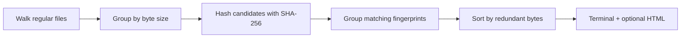

<div align="center">

# DupeLens

### Find the copies. Keep control.

**A dependency-free Java CLI that finds duplicate files and creates a clean, offline HTML report.**


</div>

```text
$ java -jar dupelens.jar ./downloads --html report.html

Scanned 5 files | 1 duplicate groups | 4 redundant bytes

4 bytes each (2 copies)
  /downloads/copy.txt
  /downloads/original.txt

Report: /reports/report.html
```

## Why DupeLens?

Backups, downloads, and exported folders accumulate copies. DupeLens shows where identical contents live, sorted by redundant bytes, without deleting or moving anything.

- **Read-only scans:** no delete command, no automatic cleanup.
- **Size-first filtering:** only files with a matching size are hashed.
- **SHA-256 fingerprints:** matching names alone never count as duplicates.
- **Bounded hashing memory:** streams files in 64 KiB chunks.
- **Portable reports:** one HTML file, no server, scripts, fonts, or network calls.
- **Hard-link awareness:** excludes repeated file identities when the filesystem provides them.
- **Practical failure handling:** unreadable files become warnings, and symbolic links are skipped.

## Quick start

Requires a **JDK 17 or newer**. Maven is optional.

```sh
# Run directly from source; no build tools required
java src/main/java/dev/dupelens/Main.java ./your-folder

# Generate a report (choose a path that does not already exist)
java src/main/java/dev/dupelens/Main.java ./your-folder --html report.html
```

Or build a runnable JAR:

```sh
mvn package
java -jar target/dupelens.jar ./your-folder --html report.html
```

Quote paths containing spaces. On Windows, for example:

```powershell
java -jar target/dupelens.jar "C:\Users\YourName\Downloads" --html "duplicates.html"
```

The report refuses to overwrite existing files. Reports contain full local paths; review them before sharing.

## How it works



A group with three 10 MB files has 20 MB of redundant contents. This is an estimate, not a promise of physically reclaimable disk space: compression, deduplication, snapshots, and filesystem allocation can change actual usage. Empty files are included with zero redundant bytes.

The scanner checks size, modification time, and file identity around hashing to catch ordinary concurrent edits. It is not an atomic filesystem snapshot; scan a stable folder for reliable results. Matching hashes are not followed by a byte-by-byte comparison. Directory metadata scales with file count, and scanning large matching files can take time. Hard-link detection depends on filesystem file-key support.

## Tests

The integration checks use temporary directories and require no test libraries:

```sh
sh scripts/test.sh
```

```powershell
./scripts/test.ps1
```

Checks cover identical contents, different contents with equal sizes, empty files, hard links where supported, missing directories, HTML escaping, and preservation of scanned files. GitHub Actions is configured for Java 17 and 21 on Linux, macOS, and Windows.

## Contributing

Small, focused contributions are welcome. See [CONTRIBUTING.md](CONTRIBUTING.md) for the development workflow. Useful next steps include exclusion patterns, machine-readable output, and cancellation support for long scans.

If DupeLens helps you understand your storage, a star helps others discover it.

## License

[MIT](LICENSE)
